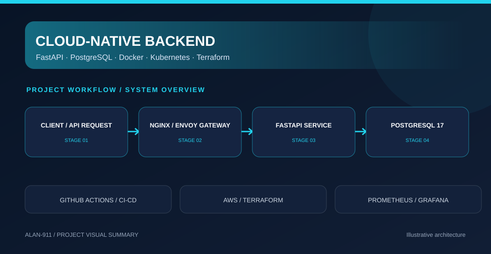
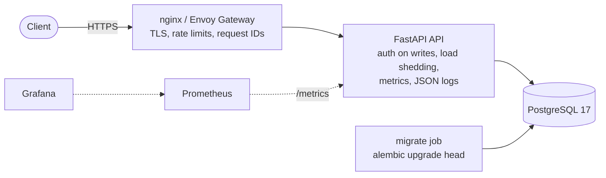

# Cloud-Native Backend Infrastructure

**Engineering portfolio case study — Backend · Cloud · DevOps · Site Reliability Engineering**

This project documents the progression from a coursework FastAPI API to a cloud infrastructure and reliability implementation. Review the [architecture](docs/architecture/README.md), [development roadmap](docs/ROADMAP.md), [benchmarks](docs/benchmarks/README.md), or [preserved academic baseline](docs/academic-submission/README.md).


[](https://github.com/Alan-911/Cloud-Computing/actions/workflows/release.yml)
[](https://github.com/Alan-911/Cloud-Computing/actions/workflows/security.yml)
[](https://github.com/Alan-911/Cloud-Computing/actions/workflows/kubernetes.yml)
[](https://github.com/Alan-911/Cloud-Computing/actions/workflows/performance.yml)
[](LICENSE)

A small REST API built to **production standards**: designed, tested, containerised,
deployed on Kubernetes and AWS, observed, secured and load-tested. Every claim below
is checked by CI or by a recorded run.

It started as a graded cloud-computing assignment: one FastAPI file, SQLite and a
manual EC2 deploy, preserved at tag [`v1.0-academic`](https://github.com/Alan-911/Cloud-Computing/tree/v1.0-academic).
It was then rebuilt in ten phases, recorded in the [roadmap](docs/ROADMAP.md).

**Deployment note:** The public IP below is an environment-specific demonstration address, not a permanent hosted endpoint. Check availability before using it.

**Live demo:** v2.0.0 runs on AWS (EC2 t4g.small, deployed by the Deploy workflow over SSM):
[`/api/health`](http://44.195.163.234/api/health) · [`/api/v1/items`](http://44.195.163.234/api/v1/items).
Writes need an API key; interactive docs are off in production. The address changes if the
environment is recreated.

## Architecture at a glance



*Illustrative overview of the API, deployment infrastructure and observability components; consult the architecture documents and workflows for implemented configurations.*

## What this demonstrates

| Area | What's here | Evidence |
|---|---|---|
| **Backend** | FastAPI service: layered package, full CRUD, validation, pagination, one error envelope | 120 tests, **99.5% branch coverage**, run on SQLite *and* PostgreSQL |
| **Data** | PostgreSQL 17, Alembic migrations as the only source of the schema, pooled connections | A drift test fails CI if models and migrations differ; backup and restore drilled |
| **Containers** | Non-root, read-only filesystem, **zero Linux capabilities**, no pip in the image, multi-arch | Checked inside the running container by CI |
| **CI/CD** | GitHub Actions: lint, tests, image, smoke test, multi-arch release to GHCR with SBOM and signed provenance; branch protection | All actions pinned to commit SHAs |
| **Infrastructure as Code** | Terraform: remote state, VPC, EC2, IAM, budget. Deploys over **SSM via GitHub OIDC** (no SSH, no stored keys) | Created, deployed to and destroyed from Terraform alone |
| **Kubernetes** | Gateway API (Envoy), probes, HPA, PDB, restricted Pod Security, default-deny NetworkPolicies | Zero-downtime rollout under load in CI: **28,177 requests, 0 failed** |
| **Observability** | JSON logs with request IDs, Prometheus RED metrics, SLO burn-rate alerts with unit tests, Grafana | Alert drill: `ApiDown` fired and cleared on recovery |
| **Security** | API keys (hashed), TLS 1.2/1.3, rate limits, security headers, CodeQL, Trivy, STRIDE threat model | **0 critical** findings; decisions recorded |
| **Performance** | k6 SLO test, capacity ramp, load shedding, failure drills | **p95 3–4 ms at 100 req/s**; a killed pod cost **0 requests** |

## Quick start (about 10 minutes)

Requires Docker with the Compose plugin, Git and Bash (on Windows, use Git Bash).

```bash
git clone https://github.com/Alan-911/Cloud-Computing.git && cd Cloud-Computing
scripts/setup-env.sh                    # .env with generated passwords and an API key
docker compose up -d --build --wait     # db -> migrations -> api -> nginx
scripts/smoke-test.sh                   # 11 checks against http://localhost
```

Then try it:

```bash
API_KEY=$(sed -n 's/^API_KEY=//p' .env)
curl -s http://localhost/api/health
curl -s -X POST http://localhost/api/v1/items -H "X-API-Key: $API_KEY" \
     -H "Content-Type: application/json" -d '{"name":"hello"}'
curl -s http://localhost/api/v1/items
curl -s -X POST http://localhost/api/v1/items -H "Content-Type: application/json" -d '{"name":"x"}'   # 401: no key
```

Interactive API docs: **http://localhost/api/docs**

Optional extras:

| Add | Command | Then |
|---|---|---|
| Prometheus and Grafana | `docker compose -f docker-compose.yml -f docker-compose.observability.yml up -d --wait` | Grafana at http://127.0.0.1:3000 (`admin` / `GRAFANA_ADMIN_PASSWORD` from `.env`) |
| HTTPS | `scripts/dev-cert.sh`, then add `-f docker-compose.tls.yml` | `curl --cacert nginx/certs/dev-ca.pem https://localhost/api/health` |
| Kubernetes | Install [kind](https://kind.sigs.k8s.io/), then `scripts/k8s-up.sh 2.0.0` | http://127.0.0.1:8088/api/health |
| Tests | `python -m venv .venv`, `pip install -r requirements-dev.txt`, `scripts/test.sh` | Add `--postgres` to run against PostgreSQL |

Stop with `docker compose down`. Add `-v` to also delete the data.

## Architecture



The same image runs on Docker Compose (local and EC2) and Kubernetes. Diagrams for
each environment, the request lifecycle, the pipeline and the design decisions are
in **[docs/architecture](docs/architecture/README.md)**.

## API

| Method | Path | Notes |
|---|---|---|
| GET | `/api/health/live` | Liveness; never touches the database |
| GET | `/api/health` | Readiness: version and database status, 503 if the database is down |
| GET | `/api/v1/items?limit=&offset=` | Paginated, with `total` |
| POST | `/api/v1/items` | **API key**. 201 with `Location` |
| GET | `/api/v1/items/{id}` | |
| PUT / PATCH | `/api/v1/items/{id}` | **API key**. Replace / partial update |
| DELETE | `/api/v1/items/{id}` | **API key**. 204 |

- **Errors** always use the same shape: `{"error": {"code", "message", "details"}}`.
- **Status codes:** `validation_error` 422, `not_found` 404, `conflict` 409, `unauthorized` 401, `rate_limited` 429. Two are temporary, so clients should retry them after `Retry-After`: `overloaded` 503 and `database_unavailable` 503.
- **Names** are unique regardless of case, enforced by the database.

## Recorded benchmark results

The figures below are **project-reported, workload-specific results** from the linked testing documentation. They should not be interpreted as a performance guarantee for other deployments, hardware, or traffic patterns.


From the [Performance workflow](docs/benchmarks/README.md) on GitHub runners (4 vCPU):

| Test | Result |
|---|---|
| Defined workload: 100 req/s for 3 min, mixed reads and writes | 18,000 requests, **0 failed**, p95 **3.0–4.2 ms** (target < 200 ms), 3 runs |
| Capacity of one process | ~300–460 req/s served. Beyond that, a fast `503 overloaded`, never timeouts |
| API pod killed under load (Kubernetes) | **0 failed** of 5,241 requests |
| Database pod killed under load | Recovered **2.8 s** after PostgreSQL was ready; no API pod restarted; data intact |
| Rolling update under load (Kubernetes) | 28,177 requests, **0 failed** |

## Repository map

```
app/              FastAPI service: api/ (HTTP), services/ (rules), models/ + database/ (data), core/ (config, errors, security, observability)
migrations/       Alembic migrations, the only source of the schema
tests/            unit/ and integration/ (pytest), performance/ (k6 scripts, traffic probe)
nginx/            reverse proxy: rate limits, request IDs, HTTP and HTTPS variants
kubernetes/       kind cluster, Gateway API, Kustomize manifests, migration Job
infrastructure/   Terraform: bootstrap (state, OIDC) and app (VPC, EC2, IAM)
monitoring/       Prometheus config, SLO rules and rule tests, Grafana dashboard
scripts/          setup, smoke test, tests, Kubernetes, drills, backups, keys, certificates
.github/          workflows: CI, Security, Release, Deploy, Kubernetes, Infrastructure, Performance
docs/             architecture, runbooks, security, benchmarks, roadmap, academic submission
```

## Documentation

| Topic | Where |
|---|---|
| Architecture and design decisions | [docs/architecture](docs/architecture/README.md) |
| Roadmap and evidence for every phase | [docs/ROADMAP.md](docs/ROADMAP.md) |
| Benchmarks (load, capacity, drills) | [docs/benchmarks](docs/benchmarks/README.md) |
| Security guide and STRIDE threat model | [docs/security](docs/security/README.md) |
| Runbooks: [database](docs/runbooks/database.md), [CI/CD](docs/runbooks/ci-cd.md), [infrastructure](docs/runbooks/infrastructure.md), [Kubernetes](docs/runbooks/kubernetes.md), [observability](docs/runbooks/observability.md), [recovery](docs/runbooks/recovery.md) | `docs/runbooks/` |
| Changes by release | [CHANGELOG.md](CHANGELOG.md) |

## Tech stack

Python 3.15 · FastAPI · SQLAlchemy 2 · Alembic · PostgreSQL 17 · Docker · nginx ·
Kubernetes (kind) · Envoy Gateway · Terraform · AWS (EC2, IAM, SSM, S3) · GitHub
Actions · Prometheus · Grafana · k6 · pytest · CodeQL · Trivy

## License

[MIT](LICENSE). The original coursework in `docs/academic-submission/` is kept for
the record.
