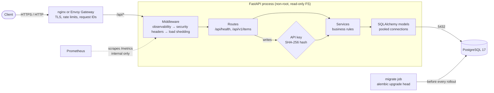
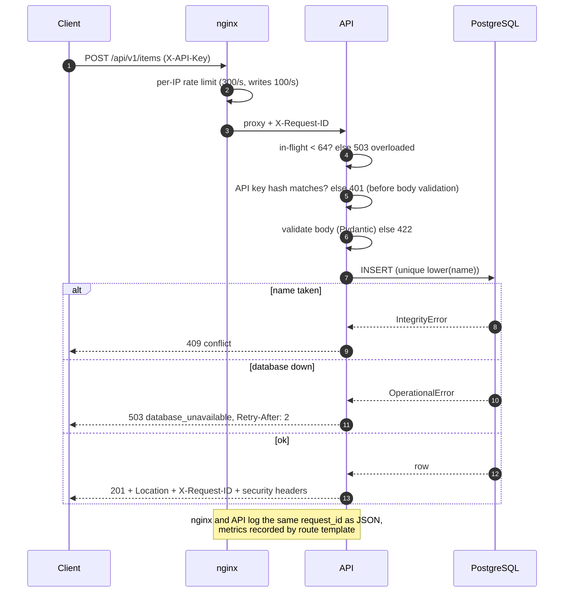
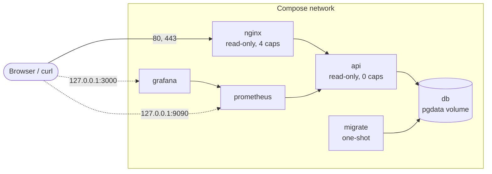
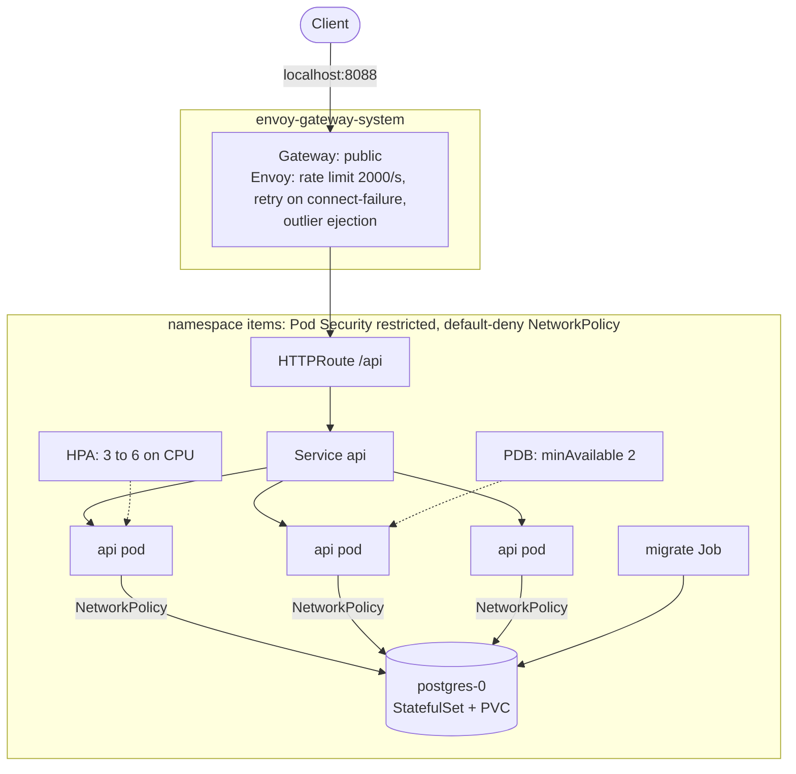
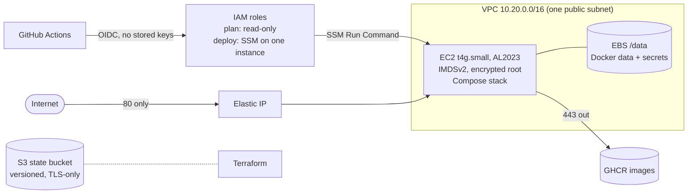
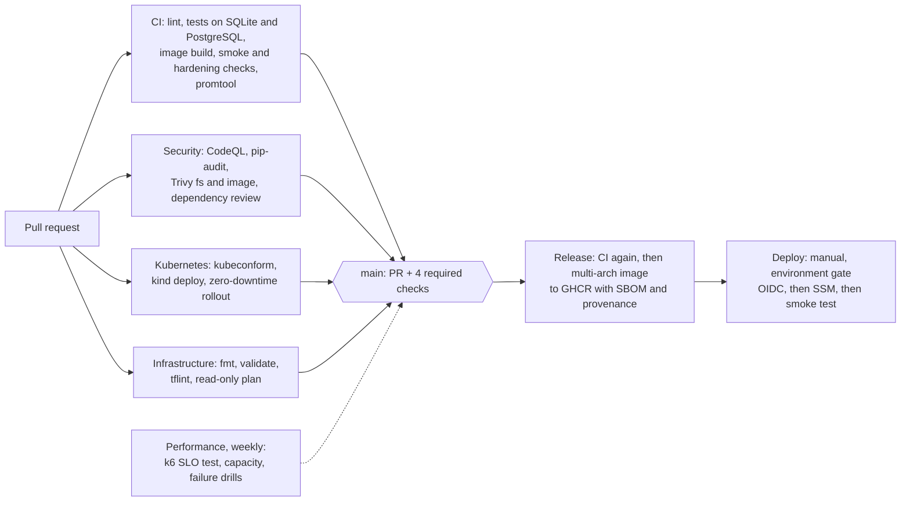

# Architecture

The same container image runs in three environments. The Compose and Kubernetes
setups are exercised on every pull request, and the AWS one was created, deployed to
and destroyed from Terraform. Requirements are in [requirements.md](requirements.md).

## 1. The application

| Layer | Responsibility |
|---|---|
| Middleware | Request IDs, JSON access logs, RED metrics; security headers; load shedding (fast 503 beyond 64 in flight) |
| Routes (`app/api`) | HTTP only: validation by Pydantic schemas, API-key check on writes, documented error responses |
| Services (`app/services`) | Business rules: case-insensitive uniqueness, not-found, conflicts |
| Data (`app/models`, `app/database`) | ORM models, pooled engine with pre-ping and timeouts; schema owned by Alembic |
| Errors (`app/core/errors.py`) | One envelope `{"error": {code, message, details}}`; DB outage → 503, never 500 |

## 2. Request lifecycle

## 3. Local stack (Docker Compose)

`docker-compose.yml` is the base; overlays add HTTPS (`docker-compose.tls.yml`),
Prometheus and Grafana (`docker-compose.observability.yml`), and the published image
for servers (`docker-compose.prod.yml`). Start order: `db` healthy → `migrate`
completed → `api` healthy → `nginx`.

## 4. Kubernetes (kind locally and in CI)

Rollouts are zero-downtime (`maxUnavailable: 0`, readiness on DB health, `preStop`
drain); verified under load in CI. Details: [Kubernetes runbook](../runbooks/kubernetes.md).

## 5. AWS (Terraform)

Bootstrap stack: state bucket, GitHub OIDC provider, read-only plan role. App stack:
network, instance, data volume, deploy role, optional budget alarm. No SSH (port 22
closed; shell via Session Manager). Cost ≈ $18/month while it exists. Details:
[infrastructure runbook](../runbooks/infrastructure.md).

## 6. Delivery pipeline

Every action is pinned to a commit SHA; Dependabot keeps them current.
Details: [CI/CD runbook](../runbooks/ci-cd.md).

## 7. Design decisions

| Decision | Why | Trade-off |
|---|---|---|
| Alembic owns the schema; app never calls `create_all` | Reviewable, reversible schema changes; a drift test fails CI if models and migrations differ | One more step on deploy (the `migrate` job) |
| API keys stored as SHA-256 hashes | Keys are 256-bit random, so a fast hash is safe; no plaintext secrets on servers | Key rotation is manual (documented) |
| Fail closed in production without keys | A missing secret can never open writes | Misconfiguration blocks writes until fixed |
| Load shedding at 64 in flight per process | Overload degrades gracefully instead of collapsing (measured: 100% timeouts → fast 503s) | Some requests rejected at peak; clients must honour `Retry-After` |
| Gateway API (Envoy) instead of Ingress | ingress-nginx was archived in March 2026 | Extra CRDs on the cluster |
| Liveness independent of the database | A DB outage must not restart API pods (verified in drills) | Readiness carries the DB signal |
| One host on AWS, no NAT gateway | Lowest cost for a portfolio environment (~$18/month) | No HA; Kubernetes covers replicas |
| SSM instead of SSH | No open port 22, no keys to leak; access is IAM-audited | Needs the SSM agent and IAM setup |
| Numbers measured on GitHub runners | Reproducible; the dev laptop's Docker VM has slow fsync | Runner-to-runner variance (reported as ranges) |
